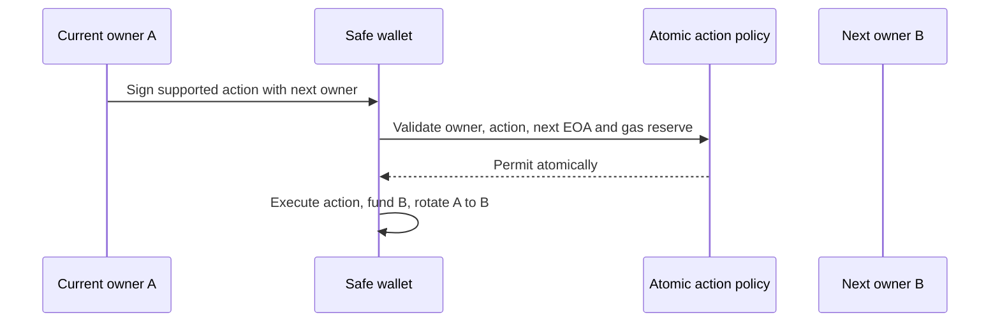
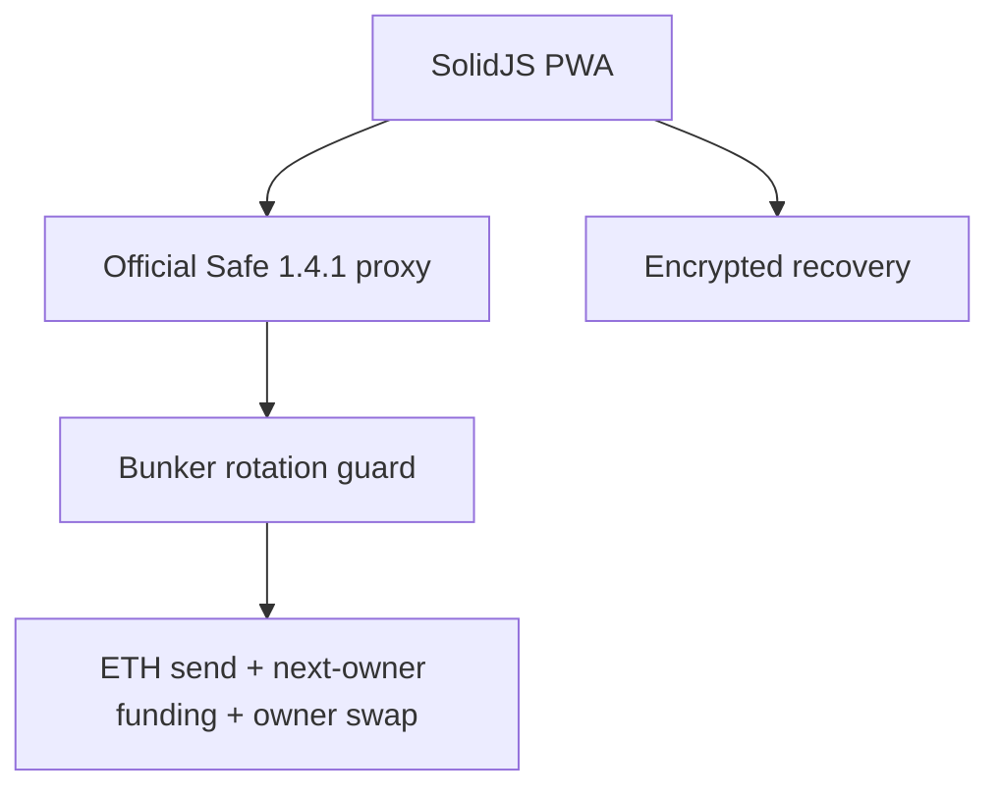

# Bunker Wallet

Bunker Wallet is a **local-first simulation** of one stable Ethereum address whose ECDSA owner advances after every supported action. Its optional unaudited Ethereum Sepolia mode deploys an official Safe 1.4.1 proxy with Bunker’s V2 dynamic rotation guard. Mainnet is disabled. Do not use meaningful funds.

ECDSA public keys become visible when an account signs. A future cryptanalytic break could make historically exposed keys more valuable targets. Bunker narrows that exposure by coupling a supported action and fresh-owner rotation in one atomic wallet operation. It is not “quantum-safe”: the pending transaction exposes a signature before confirmation, browser seed theft defeats rotation, and Ethereum still uses ECDSA.



## Current alpha

Working today:

- faucet-free local simulation plus an optional unaudited dynamic V2 Sepolia flow; hosted sites may run older releases and are not evidence that this V2 build is deployed; Test ETH only—never use mainnet ETH or meaningful funds;
- an ETH-send flow that atomically rotates to a fresh owner;
- visible stable address, contract balance, rotation index and session activity;
- polished offline-capable SolidJS PWA;
- 24-word BIP-39 creation and recovery confirmation;
- optional Argon2id + AES-256-GCM encrypted local vault;
- seed-only mode with no plaintext persistence;
- dynamically derived or locally selected next owners with permanent per-Safe historical reuse prevention;
- bounded, versioned file envelopes with strict validation and tamper checks;
- loopback-only Bun validation service with no key or broadcast ability;
- research guard source targeting official Safe contracts 1.4.1.

Blocked today:

| Integration | Status |
|---|---|
| Browser-HD creation and encrypted backup | Alpha |
| Ledger / Trezor | Disabled; physical testing required |
| Manual injected wallets | Disabled; proof-of-control design unresolved |
| Offline file validation | Alpha; not offline-verified |
| QR exchange | Deferred |
| Ethereum Sepolia Safe | Dynamic V2 validated locally; historical hosted deployment/recovery evidence applies only to its tested version; independent audit required |
| Production/mainnet Safe | Disabled pending independent audit |
| Ethereum mainnet | Runtime rejected |

## Remaining roadmap (not implemented)

- independent review of the guard, atomic setup, browser transaction construction, recovery, persistence and runtime attestation;
- expanded parser, signature-boundary, replacement, storage-attestation and reentrancy fuzz/property testing;
- independent review of dynamic signer substitution risks and recovery after intentional seed/index switches;
- physical Ledger and Trezor validation before hardware signing support;
- **private transaction submission / protected relay:** evaluate private builder or relay submission to reduce public-mempool visibility of pending ECDSA signatures and exposed public keys during rotation. This would not hide them from the selected relay, builders or validators, or from the eventual chain, and it would not make Bunker quantum-safe;
- mainnet, meaningful-funds use, arbitrary calls, modules, refunds and production relaying remain disabled.

### Live Sepolia testnet

`https://bunker.supplies` and `https://sepolia-test.bunker-wallet.pages.dev` are historical testnet deployment URLs, not independently verified deployments of this dynamic V2 build. Hosted behavior and recovery support depend on the deployed version. This branch supports dynamic V2 Standard wallets only; older fixed-sequence Standard V1/V3 guards are rejected and require their compatible client. Retained PQ paths are separate. The following workflow describes this branch’s optional V2 mode using disposable Sepolia test ETH. The flow is unaudited, may be reset without notice, and must never receive mainnet ETH or meaningful assets. Ethereum mainnet remains disabled.

1. Select **Create Wallet (Testnet)**.
2. Back up and confirm the 24-word recovery phrase.
3. Protect the browser with an optional password or browser-bound non-extractable device key.
4. Fund the displayed setup key with at least **0.03 Sepolia ETH**.
5. Create the guarded Safe wallet, then send ETH and rotate its owner atomically.

## Architecture



See [architecture](docs/architecture.md), [threat model](docs/threat-model.md), [security decisions](docs/security-decisions.md), and [security status](SECURITY_STATUS.md).

## Storage choices

**Try It (Simulation)** creates a hidden in-memory BIP-39 mnemonic and derives its stable preview address at `m/44'/60'/7331'/1'/0'` and simulated owners at fully hardened BIP-32 path `m/44'/60'/7331'/2'/index'`, with no RPC, faucet, broadcast, or persistent keys. **Create Wallet (Testnet)** requires recovery-phrase setup, verifies official Safe deployments, then atomically deploys and guards a Safe proxy before funding it. Record the stable Safe address alongside the phrase; there is no recovery backend.

**Encrypted local vault** is the opt-in persistent browser-wallet mode: it derives a 256-bit key with Argon2id, uses a fresh AES-GCM nonce, and stores only the encrypted envelope in `localStorage`. The password is cleared after use. A saved wallet survives refreshes and browser restarts using AES-GCM ciphertext and a non-extractable WebCrypto key in IndexedDB; **Lock** or cleared site data requires the vault password or recovery phrase again. Compromised same-origin code, extensions, the browser profile, or OS can still use an unlocked wallet. Passwordless setup uses the same browser-bound encrypted device record and still requires the 24-word phrase on another device. Neither mode protects an unlocked phrase from compromised page code, extensions, the browser, or OS. JavaScript cannot guarantee secure erasure.

## Offline workflow

The online coordinator will eventually export exact Safe state and calldata. The current alpha validates bounded demonstration files only. An offline-capable cached PWA is not automatically offline-verified or air-gapped. See [offline signing](docs/offline-signing.md).

## Development

Requires Bun 1.3.14.

```bash
bun install --frozen-lockfile
bun run dev
bun run typecheck
bun test
bun run build
bun run contract:compile
bun run contract:test
cargo test --release --locked --manifest-path packages/pq/c10/Cargo.toml
# With a Sepolia-forked Anvil node on port 8545:
bun run safe:smoke
# Local-only, explicitly gated live runners; never run in CI:
# bun run safe:sepolia:e2e
# bun run safe:sepolia:browser-e2e
bun run dependency:report
bun run release:verify
```

The static site builds to `apps/web/dist`, ready for Cloudflare Pages. The local validator binds only to `127.0.0.1`:

```bash
bun run relayer
```

The guard and one-shot setup helper compile with pinned solc 0.8.24 against vendored official Safe 1.4.1 sources. Checks include Bun tests, [four Foundry suites](docs/contract-test-matrix.md) with public C10/ML-DSA verifier vectors and adversarial cases, locked Cargo signer tests, a local Safe deployment/rotation smoke, and gated browser lifecycle and persistence checks. Historical browser-flow validation used controlled test recipients and does not establish hosted V2 compatibility; ENS resolution is tested separately. Independent audit and deeper fuzz/property testing remain mandatory before broader use. Current dynamic V2 run results are recorded separately in [validation evidence](docs/dynamic-rotation-validation.md). Historical live Sepolia evidence is not validation of this V2 build.

## Security model and recovery

V2 has no future commitments, batches of future keys, or 19-rotation limit. Initialization consumes the initial owner; each successful atomic rotation permanently consumes its next owner and increments a uint256 counter. A compromised current signer can select an attacker-controlled fresh owner: reuse prevention does not prevent substitution. V1 immutable Safes cannot upgrade in place; see [V2 compatibility and recovery](docs/dynamic-rotation.md). Hosted actions are limited to recipient ETH send, exact next-owner funding and owner swap; arbitrary calls, modules and refunds are rejected. Recover by matching the on-chain owner against an explicit bounded derivation range of the correct seed. Rotation count is not a derivation index. Back up the new phrase and index before a seed switch. Without recovery material, access may be permanently lost.

See [SECURITY.md](SECURITY.md) for responsible disclosure. Mainnet release is a separate decision requiring an independent review, verified deployments, reproducible evidence, and restricted-value testing.

## Licenses and thanks

Bunker Wallet is [MIT licensed](LICENSE). Vendored [Safe 1.4.1](packages/contracts/lib/@safe-global/safe-contracts/LICENSE) remains LGPL-3.0-only; the adapted [C10 signer](packages/pq/c10/LICENSE), [C10 verifier](packages/pq/verifiers/c10/LICENSE), and [ML-DSA verifier](packages/pq/verifiers/mldsa/LICENSE) retain their MIT licenses. See [dependency details](docs/dependencies.md).

Thanks to the Safe contributors, Nicolas Consigny (C10), Fireblocks Labs (ML-DSA verifier), and Paul Miller and the Noble/Scure contributors for the cryptographic foundations. Attribution does not imply their endorsement or an independent security audit of this wallet.
