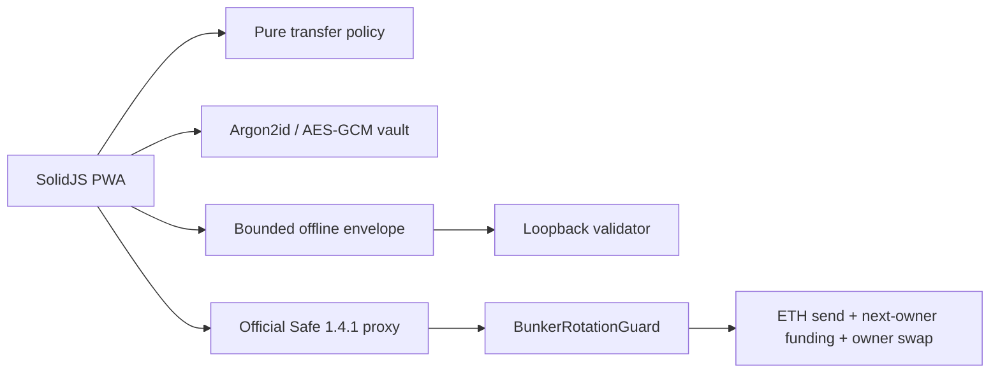

# Architecture

The browser UI is not a trust boundary. `core`, `offline`, and `vault` isolate reviewable logic but compile into the same origin.

The optional Ethereum Sepolia path verifies the canonical Safe singleton, proxy factory, and `MultiSendCallOnly` runtime hashes. It deploys the guard and one-shot setup helper, then creates the Safe proxy with guard initialization and installation inside `Safe.setup`. The proxy is attested before it receives funds.

Each supported Safe transaction is one pinned `MultiSendCallOnly` delegatecall containing exactly three calls: an ETH transfer with no calldata, `0.001 ETH` funding to the dynamically selected next EOA owner, and the Safe's exact owner swap. Modules, refunds, arbitrary calls, and guard changes are rejected. Initialization marks the initial owner consumed. Before execution the guard locks the Safe and stores only the pending owner; after successful execution it verifies ownership, permanently marks that owner consumed, increments a uint256 rotation counter, and unlocks. Any failure reverts the complete transaction. The browser derives only the next candidate, separately tracks its local index, and promotes it only after a successful receipt and owner verification. No future owner sequence is published.
